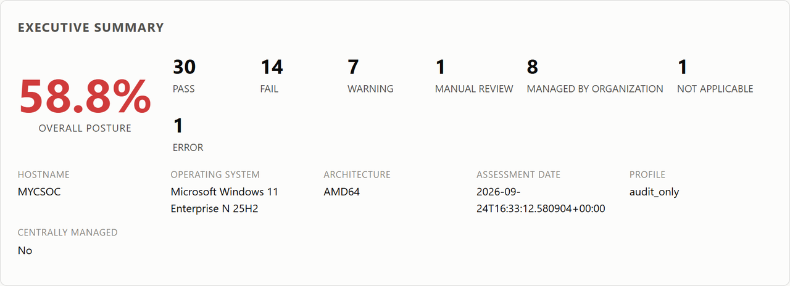
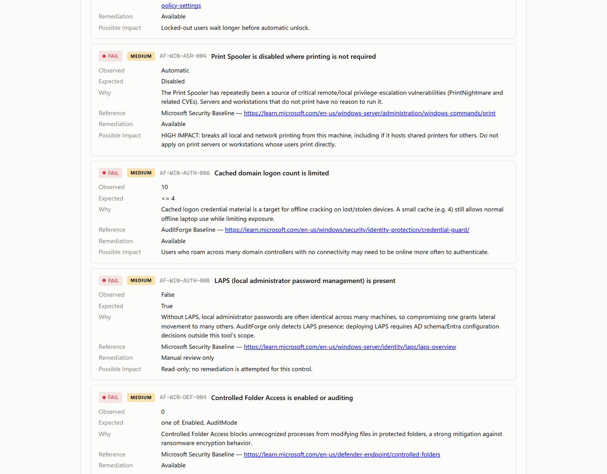
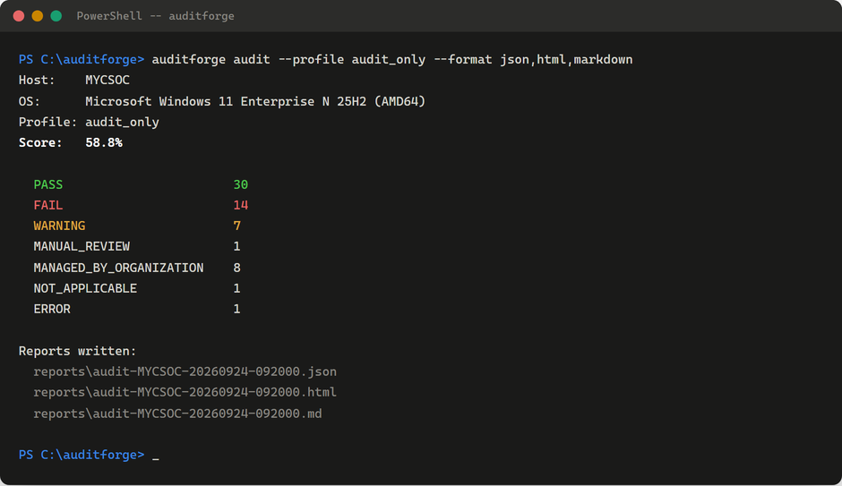
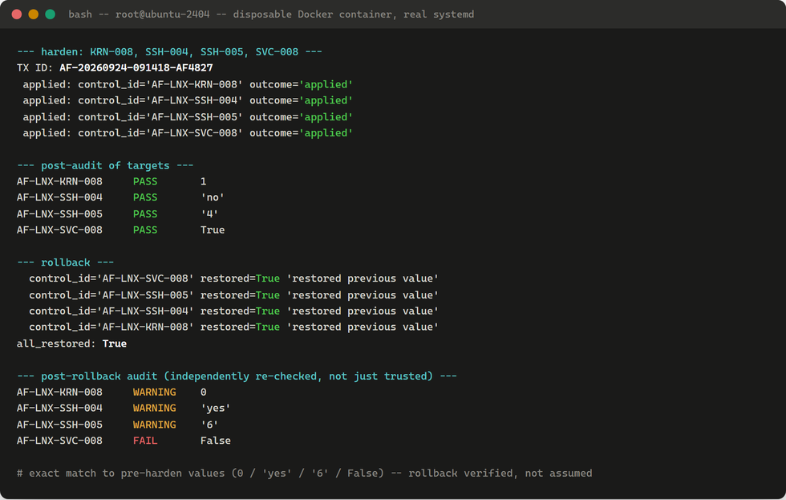
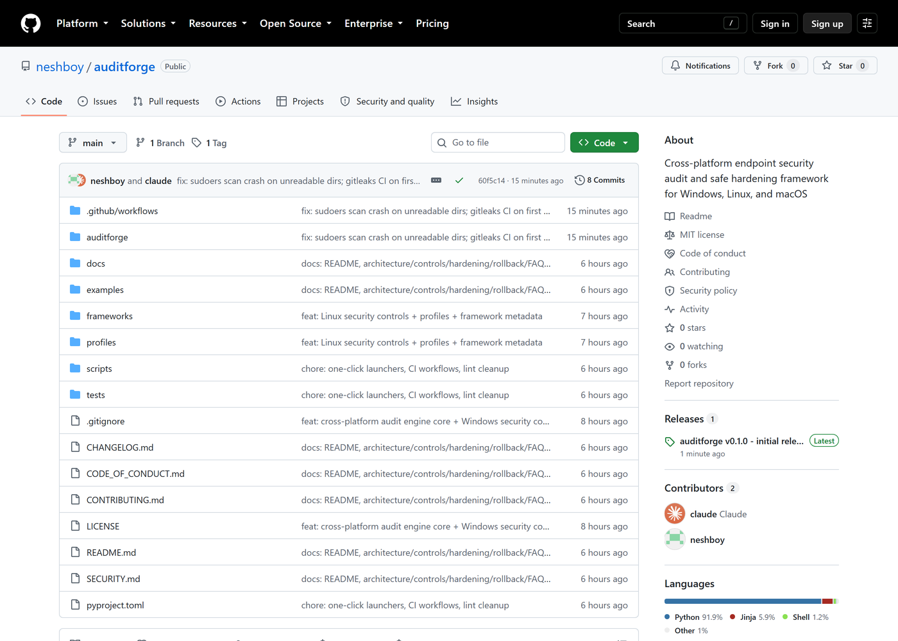
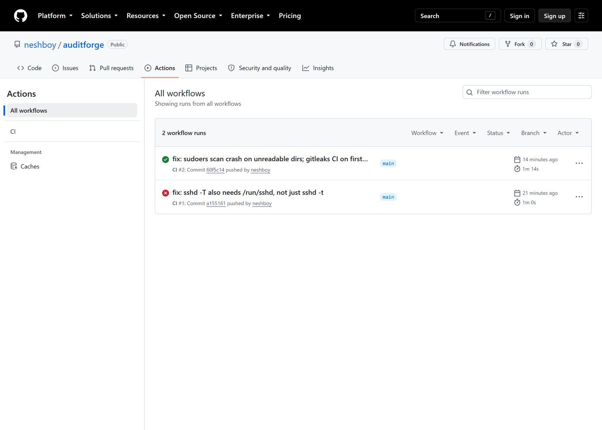
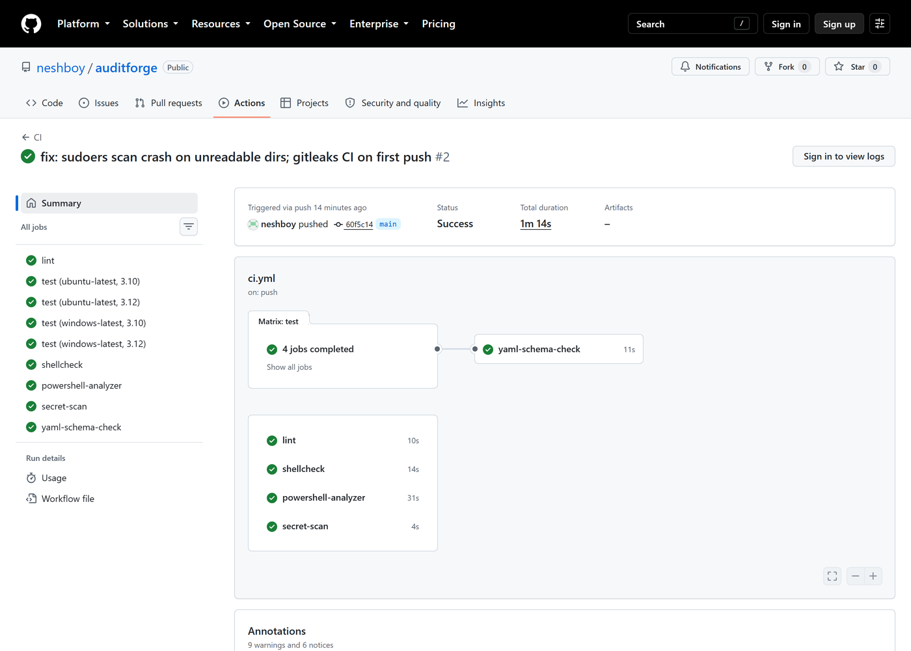

# AuditForge — Project Showcase

A visual walkthrough of AuditForge v0.1.0, with real screenshots — not mockups. Every image below is either a genuine browser capture of this project's actual generated report / actual public GitHub repository, or a styled rendering of verbatim text captured from real command runs (clearly labeled as such). Nothing here is illustrative or invented. See `docs/TEST_MATRIX.md` for the full, honest account of what was and wasn't tested, and `examples/` for the unmodified source artifacts these screenshots come from.

## What AuditForge is

```
Scan -> Audit -> Explain -> Backup -> Harden -> Verify -> Report -> Roll Back
```

A cross-platform CLI that audits a Windows, Linux, or macOS machine against current security guidance (NIST SP 800-53/800-63B-4, DISA STIGs, Microsoft Security Baselines, Apple Platform Security — all live-researched and cited in `docs/SOURCES.md`), explains every finding with evidence and a citation, and can optionally and safely remediate what it finds, with full rollback. See the main `README.md` for the complete picture; this document is the "show me" version.

## The HTML security report

Generated by `auditforge audit`, this is a real, unmodified run against this project's own Windows 11 development machine (`examples/sample-audit-report.html` — open it yourself, it's checked into the repo).

### Executive summary



### Per-category posture

Each bar is colored by real score thresholds (green >=90%, amber 70-89%, red <70%) computed from actual PASS/FAIL/WARNING counts in that category — not decoration.


### Findings, with evidence and citations

Every finding shows what was actually observed, what was expected, why it matters (in AuditForge's own words, never copied benchmark text — see `docs/SOURCES.md`'s CIS licensing note for why), a real citation, and whether remediation is available and what could break if you apply it.



## Real captured CLI output

These are exact text captured from actual runs (see `examples/cli-transcripts.md` for the raw transcripts), rendered here in a terminal-styled frame for readability — not a live OS screen capture, but not fabricated either: every character is genuine output.

### `auditforge audit` — live, this project's Windows 11 machine



### Full harden -> transaction -> rollback pipeline — live, disposable Ubuntu 24.04 container with real systemd

This is the single most important screenshot in this document: it shows AuditForge applying 4 real changes, verifying they took effect (PASS), rolling them back, and then **independently re-auditing** (not just trusting the rollback function's own report) to confirm the exact original values came back.



## Real, on GitHub

Not a demo repo — this is the actual public repository, actual CI, screenshotted live.

### The repository



### CI, including the honest failure-then-fix history

The workflow list below shows exactly what happened: the first push's CI run **failed** (red X) — pushing to real GitHub Actions infrastructure surfaced two more real bugs (a non-root permission crash in the sudoers scanner, and a gitleaks-action edge case on a repository's very first push) that local testing had missed. Both were fixed and the very next push is green.



### All 9 CI jobs green



## By the numbers

| | |
|---|---|
| Controls | 118 (62 Windows / 41 Linux / 15 macOS) |
| Primitives | 50 (24 Windows / 17 Linux / 9 macOS) |
| Unit tests | 99 (96 pass + 3 platform-skip on Windows; 99/99 on Linux) |
| Real bugs found via live testing, fixed | 9 -- see `CHANGELOG.md` "Fixed" section and the commit history for each |
| Hardening profiles | 7 |
| Report formats | 4 (HTML, JSON, CSV, Markdown) |
| CI jobs, all green on real GitHub infrastructure | 9 |

## What this document does not claim

- macOS has **not** been run on real Apple hardware — no Mac was available during development. The macOS module is real, reviewed code, but untested at the system level. See `docs/TEST_MATRIX.md`.
- The "terminal" images above are styled renderings of real captured text, not OS-level screen grabs of a live terminal window — the distinction is spelled out above so nobody mistakes one for the other.
- CI passing does not mean the product is complete — see `README.md`'s Limitations and Roadmap sections for what's explicitly not done yet (CIS/DISA per-control ID mapping, PDF reports, USG integration, and more).

## Try it yourself

```bash
git clone https://github.com/neshboy/auditforge.git
cd auditforge
# Windows
scripts\windows\Run-AuditForge.ps1 audit
# Linux / macOS
sudo ./scripts/linux/auditforge.sh audit
```

Then open the generated HTML report in `reports/`, or just open `examples/sample-audit-report.html` right now without installing anything.
